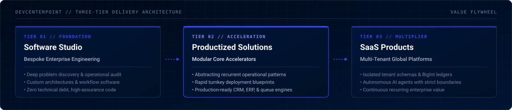
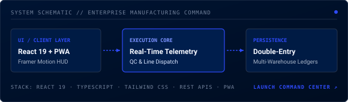
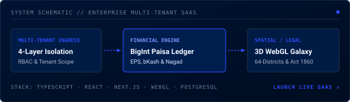
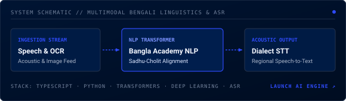
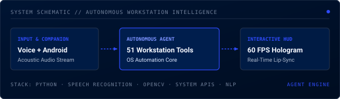
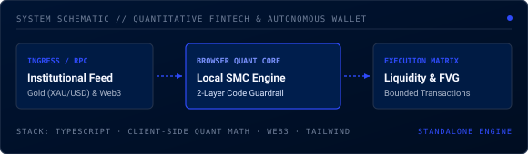
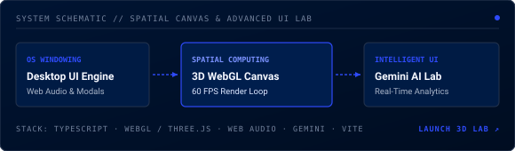
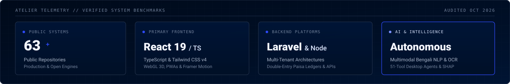
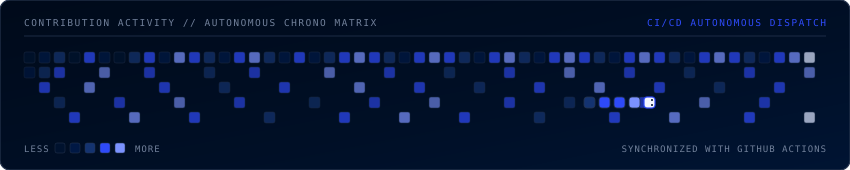

<!-- ================================================================= -->
<!-- DIGITAL ENGINEERING ATELIER // MUSHFIQUR RAHMAN AAYAN             -->
<!-- FOUNDER, DEVCENTERPOINT · FULL STACK DEVELOPER · AI BUILDER       -->
<!-- ================================================================= -->

<div align="center">
  
</div>

<br />

<!-- ================================================================= -->
<!-- QUICK TELEMETRY BADGES & JUMP NAVIGATION                          -->
<!-- ================================================================= -->

<div align="center">
  <a href="https://github.com/beingmushfiq">
    
  </a>
  &nbsp;
  
  &nbsp;
  
</div>

<br />

<div align="center">
  <a href="#01--positioning--system-architecture"><code>[ 01 // ARCHITECTURE ]</code></a> &nbsp;
  <a href="#02--selected-flagship-engineering-systems"><code>[ 02 // FLAGSHIP SYSTEMS ]</code></a> &nbsp;
  <a href="#03--technical-landscape"><code>[ 03 // TECH STACK ]</code></a> &nbsp;
  <a href="#04--engineering-philosophy"><code>[ 04 // PHILOSOPHY ]</code></a> &nbsp;
  <a href="#05--repository-telemetry--dynamic-activity"><code>[ 05 // TELEMETRY ]</code></a> &nbsp;
  <a href="#06--studio-dispatch--connect"><code>[ 06 // CONNECT ]</code></a>
</div>

<br />

<!-- ================================================================= -->
<!-- 01 // EDITORIAL POSITIONING & ARCHITECTURAL FLYWHEEL              -->
<!-- ================================================================= -->

### 01 // POSITIONING & SYSTEM ARCHITECTURE

<div align="center">
  <table width="100%" border="0" cellpadding="0" cellspacing="0">
    <tr>
      <td align="left">
        <sub><b>CORE THESIS // ARCHITECTURAL INTENT</b></sub>
        <h3>Architecting software that turns complex operational friction into resilient digital systems.</h3>
        <p>
          I work at the convergence of full-stack software engineering, applied artificial intelligence, and systems architecture. As the founder of <b>DevCenterPoint</b>, my mission is straightforward: <i>we turn inefficient business processes into software</i>. Rather than assembling disposable prototypes or chasing framework trends, I design and deliver high-assurance platforms—from manufacturing command centers with double-entry ledgers to multimodal computational linguistics and autonomous workstation agents.
        </p>
      </td>
    </tr>
  </table>
</div>

<br />

<!-- OPERATIONAL FOCUS & DISPATCH HUD -->
<table width="100%">
  <tr>
    <td width="50%" valign="top">
      <sub><b>CURRENT ENGINEERING FOCUS</b></sub><br />
      🔭 <b>Active Build:</b> Scalable multi-tenant SaaS &amp; production manufacturing ERPs<br />
      ⚡ <b>Exploring:</b> Real-time WebGL spatial computing &amp; client-side quant modeling<br />
      📍 <b>Base &amp; Reach:</b> Dhaka, Bangladesh · Collaborating globally across US, EU &amp; APAC
    </td>
    <td width="50%" valign="top">
      <sub><b>TECHNICAL DISCOURSE &amp; CONSULTING</b></sub><br />
      💬 <b>Ask Me About:</b> High-assurance architectures, double-entry paisa ledgers, React 19 concurrent state, Laravel 12/13 internals, and Bengali NLP transformers<br />
      🧠 <b>Nuance:</b> Literature background bridging formal logic with human meaning
    </td>
  </tr>
</table>

<br />

<div align="center">
  
</div>

<br />

<p align="center">
  
</p>

<!-- ================================================================= -->
<!-- 02 // SELECTED FLAGSHIP ENGINEERING SYSTEMS                       -->
<!-- ================================================================= -->

### 02 // SELECTED FLAGSHIP SYSTEMS

A curated 6-system matrix spanning enterprise operational SaaS, multimodal intelligence, browser-based quantitative mathematics, and spatial WebGL computing.

<br />

#### 01. CenterPoint ProERP — Enterprise Manufacturing Command Center

<div align="center">
  <a href="https://github.com/beingmushfiq/CenterPoint-ProERP">
    
  </a>
</div>

* **Domain &amp; Problem:** Industrial production management. Replaces error-prone manual paper logs and fragmented spreadsheets across factory floors with a unified, real-time command center.
* **Engineering &amp; Architecture:** Engineered with React 19, TypeScript, and a low-latency Progressive Web App (PWA) shell. Unifies live shop-floor production telemetry, multi-warehouse FIFO inventory valuation, shift workforce allocation, automated QC tolerance validation, and an immutable double-entry financial ledger that bridges factory operations with corporate accounting.
* **Core Stack:** `React 19` `TypeScript` `Tailwind CSS` `Framer Motion` `REST APIs` `PWA`
* **Artifacts &amp; Deployment:** [View Repository](https://github.com/beingmushfiq/CenterPoint-ProERP) · [Live Production Command Center](https://demoerp.devcenterpoint.com)

<br />

#### 02. ORG Management System — Multi-Tenant Syndicate Governance SaaS

<div align="center">
  <a href="https://github.com/beingmushfiq/ORG-Management-System">
    
  </a>
</div>

* **Domain &amp; Problem:** Institutional governance &amp; subscription finance. Solves member record fragmentation, opaque fee collection, and statutory compliance for institutional bodies and civic foundations.
* **Engineering &amp; Architecture:** Features a 4-layer tenant schema isolation architecture ensuring complete data privacy between syndicates. Includes a high-precision BigInt paisa ledger that natively integrates with domestic payment gateways (bKash, Nagad, EPS) with zero floating-point rounding errors, an interactive 3D WebGL branch galaxy across 64 administrative districts, and statutory Societies Act 1860 reporting automation.
* **Core Stack:** `TypeScript` `React 19` `Next.js / Node.js` `WebGL 3D` `PostgreSQL`
* **Artifacts &amp; Deployment:** [View Repository](https://github.com/beingmushfiq/ORG-Management-System) · [Live Web Platform](https://org-management-web.vercel.app)

<br />

#### 03. KothaLipi AI — Multimodal Bengali Linguistics &amp; Acoustic Engine

<div align="center">
  <a href="https://github.com/beingmushfiq/KothaLipi-AI">
    
  </a>
</div>

* **Domain &amp; Problem:** Computational linguistics &amp; speech recognition. Addresses the critical scarcity of high-accuracy NLP infrastructure, OCR, and dialect-resilient acoustic models for the Bengali language.
* **Engineering &amp; Architecture:** A multimodal pipeline developed by DevCenterPoint. Integrates a neural document OCR engine trained on complex conjunct characters (যুক্তবর্ণ), an automated Bangla Academy standard syntax and grammar proofreader, a historical Sadhu-to-Cholit (সাধু-চলিত) register converter, and an acoustic speech-to-text pipeline with phonetic regional dialect alignment.
* **Core Stack:** `TypeScript` `Python` `Transformers` `Deep Learning` `Speech-to-Text (ASR)` `OCR`
* **Artifacts &amp; Deployment:** [View Repository](https://github.com/beingmushfiq/KothaLipi-AI) · [Live Studio Engine](https://kothalipi.ai.studio)

<br />

#### 04. Ultron AI — Voice-First Autonomous Workstation Intelligence

<div align="center">
  <a href="https://github.com/beingmushfiq/Ultron">
    
  </a>
</div>

* **Domain &amp; Problem:** Autonomous operating system agents. Eliminates repetitive desktop application multitasking by commanding workstation workflows via voice and mobile companion.
* **Engineering &amp; Architecture:** A voice-first desktop agent built in Python featuring 51 native execution tools spanning system diagnostics, window manipulation, file indexing, and process scripting. Features a 60 FPS hardware-accelerated holographic HUD, acoustic waveform lip-sync synchronization, and a local socket bridge that allows secure command dispatch from an Android device.
* **Core Stack:** `Python` `Transformers / NLP` `Computer Vision` `Speech Recognition / TTS` `Socket Protocols`
* **Artifacts &amp; Deployment:** [View Repository](https://github.com/beingmushfiq/Ultron)

<br />

#### 05. XAU/USD Gold SMC Blueprint &amp; Guardian AI Wallet

<div align="center">
  <a href="https://github.com/beingmushfiq/XAUUSD-Gold-SMC-Blueprint">
    
  </a>
</div>

* **Domain &amp; Problem:** Algorithmic financial analysis &amp; autonomous Web3 transactions. Eliminates reliance on proprietary server script engines like TradingView while enforcing unhackable code-level execution boundaries for AI-directed funds.
* **Engineering &amp; Architecture:** Standalone institutional algorithmic trading dashboard that bypasses PineScript by executing complex Smart Money Concept (SMC) mathematics (Liquidity Sweeps, Order Blocks, Fair Value Gaps) directly in the client browser with zero latency against live institutional feeds. Paired with [Guardian Wallet](https://github.com/beingmushfiq/Guardian-Wallet), a dual-layer autonomous AI wallet whose spending authority is strictly governed by immutable smart contract logic.
* **Core Stack:** `TypeScript` `Quantitative SMC Math` `Web3 Smart Contracts` `Tailwind CSS` `WebSocket Feeds`
* **Artifacts &amp; Deployment:** [View SMC Blueprint](https://github.com/beingmushfiq/XAUUSD-Gold-SMC-Blueprint) · [Live SMC Dashboard](https://xauusd-gold-smc-blueprint.vercel.app) · [View Guardian Wallet](https://github.com/beingmushfiq/Guardian-Wallet)

<br />

#### 06. The Frontend Experience Lab &amp; Spatial 3D Engine

<div align="center">
  <a href="https://github.com/beingmushfiq/The-Frontend-Experience-Lab">
    
  </a>
</div>

* **Domain &amp; Problem:** Advanced creative frontend engineering &amp; spatial interface computing. Explores the boundary of desktop-grade web applications through multi-window virtualization, WebGL 3D graphics, and contextual AI assistants.
* **Engineering &amp; Architecture:** A high-craft laboratory combining a desktop window management system, Web Audio synthesis, interactive 3D WebGL spatial canvas rendering, and server-side Google Gemini AI reasoning with high thinking levels. Designed with strict 60 FPS animation pipelines, real-time diagnostic telemetry, and accessible keyboard-driven navigation (`Ctrl + K`).
* **Core Stack:** `TypeScript` `WebGL / Three.js` `Web Audio API` `Gemini AI` `Tailwind CSS` `Vite`
* **Artifacts &amp; Deployment:** [View Repository](https://github.com/beingmushfiq/The-Frontend-Experience-Lab) · [Live Experience Lab](https://the-frontend-experience-lab.vercel.app)

<br />

<p align="center">
  
</p>

<!-- ================================================================= -->
<!-- 03 // TECHNOLOGY LANDSCAPE & SYSTEM CORE                          -->
<!-- ================================================================= -->

### 03 // TECHNICAL LANDSCAPE

Curated competencies verified by active production codebases, multi-tenant architectures, and public repositories.

<br />

| Domain | Core Technologies &amp; Implementation Depth |
| :--- | :--- |
| **Languages** | `TypeScript` `JavaScript (ESNext)` `Python` `PHP (8.x)` `SQL` |
| **Frontend &amp; Spatial** | `React (18 / 19)` `Next.js` `Vite` `Tailwind CSS (v3 / v4)` `Framer Motion` `WebGL / Three.js` |
| **Backend &amp; Distributed Systems** | `Laravel (PHP)` `Node.js` `Express` `RESTful API Architecture` `WebSocket Event Streams` |
| **Databases &amp; State** | `PostgreSQL` `MySQL` `MongoDB` `Redis (Caching &amp; Queues)` `SQLite` |
| **AI, NLP &amp; Intelligence** | `Transformers` `Google Gemini API` `OpenAI API` `LangChain` `SHAP (Explainable ML)` `OCR &amp; ASR Pipelines` |
| **DevOps &amp; Infrastructure** | `Git &amp; GitHub Actions CI/CD` `Linux / Shell Scripting` `Docker` `Postman (API Validation)` `Vercel Platform` |

<br />

<p align="center">
  
</p>

<!-- ================================================================= -->
<!-- 04 // ENGINEERING PHILOSOPHY & FOUNDATIONS                        -->
<!-- ================================================================= -->

### 04 // ENGINEERING PHILOSOPHY

Four foundational principles that govern every system designed and built at DevCenterPoint.

```
┌───────────────────────────────────────┐   ┌───────────────────────────────────────┐
│  01 // UNDERSTAND THE PROBLEM FIRST   │   │  02 // BUILD WITH PURPOSE & RESTRAINT │
│  Software begins with deep operational│   │  Complexity is a liability. We choose │
│  reality—not technology hype. We map  │   │  high-assurance modular architecture, │
│  workflows, isolate bottlenecks, and  │   │  clean domain boundaries, and zero    │
│  write code where it creates leverage.│   │  speculative dependency bloat.        │
└───────────────────────────────────────┘   └───────────────────────────────────────┘
                    │                                           │
                    ▼                                           ▼
┌───────────────────────────────────────┐   ┌───────────────────────────────────────┐
│  03 // USE AI AS AN ACCELERATOR       │   │  04 // DELIVER WORKING SOFTWARE       │
│  We leverage neural models and LLMs   │   │  The real benchmark is production. We │
│  for reasoning, parsing, and velocity,│   │  value ledger auditability, data      │
│  anchored by deterministic code-level │   │  integrity, and resilient workflows   │
│  guardrails and human verification.   │   │  over superficial demonstration apps. │
└───────────────────────────────────────┘   └───────────────────────────────────────┘
```

> **The Intersection of Logic and Narrative:**  
> With an academic background in literature paired with full-stack systems engineering, I approach software as both formal logic and structured human narrative. Where conventional development often treats code as isolated syntax, I design software with conceptual clarity, architectural coherence, and deep respect for the human workflows it serves.

<br />

#### Academic Foundation &amp; Verified Certifications

* 🎓 **Honours in English (Ongoing Masters):** Rigorous background in textual hermeneutics, semantic analysis, and structured language systems.
* 📊 **Google Data Analytics Professional Certification:** Applied statistical analysis, relational data pipelines, and quantitative metrics.
* 🤖 **IBM Data Science Professional Certification:** Machine learning workflows, predictive modeling, and computational exploratory analysis.

<br />

<p align="center">
  
</p>

<!-- ================================================================= -->
<!-- 05 // VERIFIED REPOSITORY TELEMETRY & ACTIVITY                    -->
<!-- ================================================================= -->

### 05 // REPOSITORY TELEMETRY & DYNAMIC ACTIVITY

Transparent activity metrics and autonomous contribution tracking synchronized via GitHub Actions.

<div align="center">
  
</div>

<br />

<div align="center">
  <a href="https://github.com/beingmushfiq">
    
  </a>
</div>

<br />

#### Dynamic Production Dispatch Feed

The table below is autonomously maintained via daily GitHub Actions execution, logging the latest public repository commits, system releases, and active deployment updates:

<!-- RECENT_ACTIVITY:START -->
| System / Repository | Dispatch Type | Description &amp; Commit Narrative | Timestamp |
| :--- | :--- | :--- | :--- |
| [**Everything-SEO**](https://github.com/beingmushfiq/Everything-SEO) | `Production Release` | Everything SEO v1.4.0 — Master SEO Orchestrator & Autonomous Prompt Activation | `2026-10-29` |
| [**Everything-SEO**](https://github.com/beingmushfiq/Everything-SEO) | `Production Release` | Everything SEO v1.3.0: Forensic Triage & Intent Routing Engine | `2026-10-29` |
| [**Everything-SEO**](https://github.com/beingmushfiq/Everything-SEO) | `Production Release` | Everything SEO v1.2.1: Self-Contained Skill Bundling, Essential Starter Pack & Automated Cursor Rules | `2026-10-29` |
| [**Everything-SEO**](https://github.com/beingmushfiq/Everything-SEO) | `Production Release` | Everything SEO v1.2.0: SEO-Eval Benchmark Suite, Community Registry & Repository Purification | `2026-10-29` |
| [**Everything-SEO**](https://github.com/beingmushfiq/Everything-SEO) | `Production Release` | Everything SEO v1.1.0: Universal Agent Interoperability & MCP Architecture | `2026-10-29` |
<!-- RECENT_ACTIVITY:END -->

<br />

<p align="center">
  
</p>

<!-- ================================================================= -->
<!-- 06 // CONNECT & STUDIO DISPATCH                                   -->
<!-- ================================================================= -->

### 06 // STUDIO DISPATCH & CONNECT

Available for select enterprise engineering contracts, software architecture consulting, and high-impact digital product development.

<br />

| Channel | Destination &amp; Purpose | Link |
| :--- | :--- | :--- |
| **Engineering Studio** | **DevCenterPoint** — Enterprise software, cloud platforms &amp; digital solutions | [devcenterpoint.com](https://devcenterpoint.com) |
| **Personal Portfolio** | **buildwithmushfiq** — Selected systems engineering &amp; AI portfolio | [buildwithmushfiq.vercel.app](https://buildwithmushfiq.vercel.app) |
| **LinkedIn** | Professional network, engineering discourse &amp; career background | [linkedin.com/in/buildwithmushfiq](https://www.linkedin.com/in/buildwithmushfiq) |
| **Freelance Direct** | Upwork verified talent profile for enterprise contracting | [upwork.com/freelancers/~01d50b68a59610140c](https://www.upwork.com/freelancers/~01d50b68a59610140c) |
| **Direct Dispatch** | Direct correspondence for technical inquiries and partnerships | [beingmushfiq@gmail.com](mailto:beingmushfiq@gmail.com) |

<br />

<div align="center">
  <sub>DEVCENTERPOINT · DIGITAL ENGINEERING ATELIER · DHAKA, BANGLADESH · 23.8103° N, 90.4125° E</sub>
  <br />
  <sub><i>“We turn inefficient business processes into software.”</i></sub>
  <br /><br />
  <sub>⭐ <i>Found value in these architectural patterns or open-source engines? Repository stars and technical discussions are always appreciated.</i></sub>
</div>
