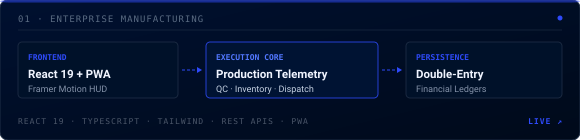
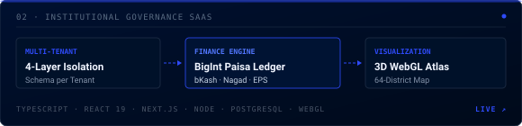
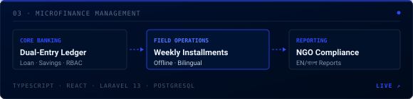
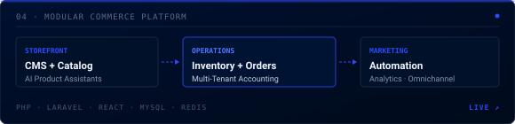
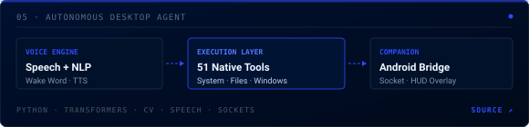

<!-- ═══════════════════════════════════════════════════════════════ -->
<!-- MUSHFIQUR RAHMAN · FULL STACK DEVELOPER · AI BUILDER          -->
<!-- GITHUB PROFILE README                                          -->
<!-- ═══════════════════════════════════════════════════════════════ -->

  

 

  
  &nbsp;
  

 

<!-- ═══════════════════════════════════════════════════════════════ -->
<!-- ABOUT                                                          -->
<!-- ═══════════════════════════════════════════════════════════════ -->

### About

I'm a full-stack developer based in Dhaka, Bangladesh. I build web applications, SaaS platforms, and business tools — primarily with **React**, **TypeScript**, **Laravel**, and **Node.js**. I also work with **Python** for AI-assisted features and data-driven applications.

Most of what I build solves operational problems: manufacturing ERPs, microfinance platforms, multi-tenant governance systems, e-commerce engines. I care about getting the architecture right, making sure the numbers add up, and shipping software that actually works in production.

I run **[DevCenterPoint](https://devcenterpoint.com)**, a small software studio focused on turning business problems into reliable digital systems.

 

  

<!-- ═══════════════════════════════════════════════════════════════ -->
<!-- WHAT I BUILD                                                   -->
<!-- ═══════════════════════════════════════════════════════════════ -->

### What I Build

<table>
  <tr>
    <td width="33%" valign="top">
      <b>FULL-STACK WEB APPS</b> 
      Production web applications with modern frontend frameworks and server-side backends. Multi-page dashboards, real-time interfaces, PWAs.
    </td>
    <td width="33%" valign="top">
      <b>SAAS & MULTI-TENANT SYSTEMS</b> 
      Subscription platforms with tenant isolation, role-based access, payment integrations, and domain-specific business logic.
    </td>
    <td width="33%" valign="top">
      <b>BUSINESS & OPERATIONS SOFTWARE</b> 
      ERPs, CRMs, inventory systems, financial ledgers, order management, and process automation for real business workflows.
    </td>
  </tr>
  <tr>
    <td width="33%" valign="top">
      <b>E-COMMERCE PLATFORMS</b> 
      Complete commerce engines with dynamic storefronts, catalog management, checkout flows, and integrated accounting.
    </td>
    <td width="33%" valign="top">
      <b>AI-ASSISTED APPLICATIONS</b> 
      Applications integrating LLM reasoning, NLP pipelines, voice interfaces, and explainable ML for practical use cases.
    </td>
    <td width="33%" valign="top">
      <b>APIS & BACKEND SYSTEMS</b> 
      RESTful architectures, real-time WebSocket services, background job processing, and database-driven backends.
    </td>
  </tr>
</table>

 

  

<!-- ═══════════════════════════════════════════════════════════════ -->
<!-- FEATURED PROJECTS                                              -->
<!-- ═══════════════════════════════════════════════════════════════ -->

### Featured Projects

A selection of systems that represent the range and depth of what I build. Each addresses a real operational problem.

 

#### CenterPoint ProERP

  

Enterprise manufacturing command center. Replaces paper logs and fragmented spreadsheets across factory floors with unified production management — real-time line telemetry, multi-warehouse FIFO inventory, shift workforce allocation, QC validation, and an immutable double-entry financial ledger.

**Stack:** `React 19` `TypeScript` `Tailwind CSS` `Framer Motion` `REST APIs` `PWA`
 
[Live Demo](https://demoerp.devcenterpoint.com) · [Repository](https://github.com/beingmushfiq/CenterPoint-ProERP)

 

#### ORG Management System

  

Multi-tenant SaaS for institutional governance — syndicates, civic foundations, and professional bodies in Bangladesh. Features 4-layer tenant schema isolation, a BigInt paisa ledger with domestic payment gateway integration (bKash, Nagad), a 3D WebGL branch visualization across 64 districts, and statutory Societies Act 1860 reporting.

**Stack:** `TypeScript` `React 19` `Next.js` `Node.js` `PostgreSQL` `WebGL`
 
[Live Platform](https://org-management-web.vercel.app) · [Repository](https://github.com/beingmushfiq/ORG-Management-System)

 

#### NGO Management System

  

Core microfinance and savings management platform for NGOs and MFIs. Dual-entry ledger accounting, weekly loan installment tracking, savings vaults, custom RBAC, offline resilience, and bilingual support (English/বাংলা). Built for organizations managing member finances at scale.

**Stack:** `TypeScript` `React` `Laravel 13` `PostgreSQL`
 
[Live Demo](https://ngodemo-dcp.vercel.app) · [Repository](https://github.com/beingmushfiq/NGO-Management-System)

 

#### E-commerce PointOne

  

Modular, multi-tenant SaaS e-commerce platform. Full commerce engine with advanced inventory management, integrated accounting, AI product assistants, storefront CMS, marketing automation, analytics, and omnichannel integrations. Designed for operators managing multiple storefronts from a single backend.

**Stack:** `PHP` `Laravel` `React` `MySQL` `Redis`
 
[Live Platform](https://ecommerce.devcenterpoint.com) · [Repository](https://github.com/beingmushfiq/E-commerce-PointOne)

 

#### Ultron AI

  

Voice-first autonomous desktop agent built in Python. 51 native execution tools spanning system diagnostics, window manipulation, file indexing, and process scripting. Features a hardware-accelerated holographic HUD, acoustic waveform lip-sync, and a local socket bridge for secure command dispatch from an Android companion app.

**Stack:** `Python` `Transformers` `Computer Vision` `Speech Recognition` `Socket Protocols`
 
[Repository](https://github.com/beingmushfiq/Ultron)

 

<b>More Projects</b>

 

| Project | What It Does | Stack | Links |
| :--- | :--- | :--- | :--- |
| **CQMP** | Real-time clinic queue management — connects receptionists, doctors, and patients through a live-updating dashboard | `TypeScript` `React` | [Live](https://cqmp.vercel.app) · [Repo](https://github.com/beingmushfiq/CQMP) |
| **AutoCanvas** | AI-powered social media management SaaS — plan, create, schedule, and publish across platforms | `TypeScript` | [Live](https://autocanvas.devcenterpoint.com) · [Repo](https://github.com/beingmushfiq/AutoCanvas) |
| **KothaLipi AI** | Bengali multimodal AI — document OCR, grammar proofreading, Sadhu-Cholit conversion, dialect-resilient speech-to-text | `TypeScript` `Python` `Transformers` | [Repo](https://github.com/beingmushfiq/KothaLipi-AI) |
| **CodeCrafts Invoice** | Invoice and proposal generator for agencies and freelancers — quotations, payment schedules, PDF export | `JavaScript` | [Live](https://code-crafts-invoice-creator.vercel.app) · [Repo](https://github.com/beingmushfiq/CodeCrafts-Invoice-Creator) |
| **Baki Bondhu** | Voice-first business management — operators manage their business by speaking in their native language | `Kotlin` | [Repo](https://github.com/beingmushfiq/Baki-Bondhu) |
| **Guardian Wallet** | Autonomous AI wallet with dual-layer code-enforced spending authority — even a compromised LLM cannot move funds outside limits | `HTML` `Smart Contracts` | [Live](https://guardianwallet.devcenterpoint.com) · [Repo](https://github.com/beingmushfiq/Guardian-Wallet) |
| **SHAP Career Predictor** | Explainable career prediction using dual-model XGBoost + Random Forest with SHAP interpretability | `Python` `XGBoost` `SHAP` | [Repo](https://github.com/beingmushfiq/SHAP-Driven-Career-Predictor) |
| **Frontend Experience Lab** | Advanced frontend engineering showcase — desktop window management, WebGL 3D canvas, Web Audio, Gemini AI integration | `TypeScript` `WebGL` `Three.js` | [Live](https://the-frontend-experience-lab.vercel.app) · [Repo](https://github.com/beingmushfiq/The-Frontend-Experience-Lab) |

 

  

<!-- ═══════════════════════════════════════════════════════════════ -->
<!-- TECHNOLOGY STACK                                               -->
<!-- ═══════════════════════════════════════════════════════════════ -->

### Technology Stack

Technologies verified through active repositories and production codebases.

 

| | Technologies |
| :--- | :--- |
| **Languages** | `TypeScript` `JavaScript` `Python` `PHP` `SQL` `Kotlin` |
| **Frontend** | `React 18/19` `Next.js` `Vite` `Tailwind CSS` `Framer Motion` `WebGL / Three.js` |
| **Backend** | `Laravel` `Node.js` `Express` `REST APIs` `WebSocket` |
| **Databases** | `PostgreSQL` `MySQL` `MongoDB` `Redis` `SQLite` |
| **AI & ML** | `Transformers` `Google Gemini API` `OpenAI API` `SHAP` `OCR` `Speech Recognition` |
| **DevOps** | `Git` `GitHub Actions` `Docker` `Linux` `Vercel` |

 

  

<!-- ═══════════════════════════════════════════════════════════════ -->
<!-- CURRENT FOCUS                                                  -->
<!-- ═══════════════════════════════════════════════════════════════ -->

### Current Focus

Right now I'm primarily working on multi-tenant SaaS architecture and production business systems through DevCenterPoint — ERPs, e-commerce engines, and microfinance platforms for the Bangladeshi market. I'm also spending time on AI-assisted development workflows — finding practical ways to integrate LLM reasoning into real applications rather than building wrappers around chat APIs. Beyond that, I'm exploring better patterns for full-stack application architecture, specifically around tenant isolation, financial ledger integrity, and offline-capable frontends.

 

  

<!-- ═══════════════════════════════════════════════════════════════ -->
<!-- GITHUB ACTIVITY                                                -->
<!-- ═══════════════════════════════════════════════════════════════ -->

### GitHub Activity

  
  &nbsp;
  

 

  

 

  

 

#### Recent Activity

<!-- RECENT_ACTIVITY:START -->
| System / Repository | Dispatch Type | Description &amp; Commit Narrative | Timestamp |
| :--- | :--- | :--- | :--- |
| [**Everything-SEO**](https://github.com/beingmushfiq/Everything-SEO) | `Production Release` | Everything SEO v1.4.0 — Master SEO Orchestrator & Autonomous Prompt Activation | `2026-10-29` |
| [**Everything-SEO**](https://github.com/beingmushfiq/Everything-SEO) | `Production Release` | Everything SEO v1.3.0: Forensic Triage & Intent Routing Engine | `2026-10-29` |
| [**Everything-SEO**](https://github.com/beingmushfiq/Everything-SEO) | `Production Release` | Everything SEO v1.2.1: Self-Contained Skill Bundling, Essential Starter Pack & Automated Cursor Rules | `2026-10-29` |
| [**Everything-SEO**](https://github.com/beingmushfiq/Everything-SEO) | `Production Release` | Everything SEO v1.2.0: SEO-Eval Benchmark Suite, Community Registry & Repository Purification | `2026-10-29` |
| [**Everything-SEO**](https://github.com/beingmushfiq/Everything-SEO) | `Production Release` | Everything SEO v1.1.0: Universal Agent Interoperability & MCP Architecture | `2026-10-29` |
<!-- RECENT_ACTIVITY:END -->

 

  

<!-- ═══════════════════════════════════════════════════════════════ -->
<!-- CONNECT                                                        -->
<!-- ═══════════════════════════════════════════════════════════════ -->

### Connect

  [**DevCenterPoint**](https://devcenterpoint.com) · [**Portfolio**](https://buildwithmushfiq.vercel.app) · [**LinkedIn**](https://www.linkedin.com/in/buildwithmushfiq) · [**Upwork**](https://www.upwork.com/freelancers/~01d50b68a59610140c) · [**Email**](mailto:beingmushfiq@gmail.com)

 

  Dhaka, Bangladesh · UTC+6
   
  Available for software development contracts and technical collaboration.

